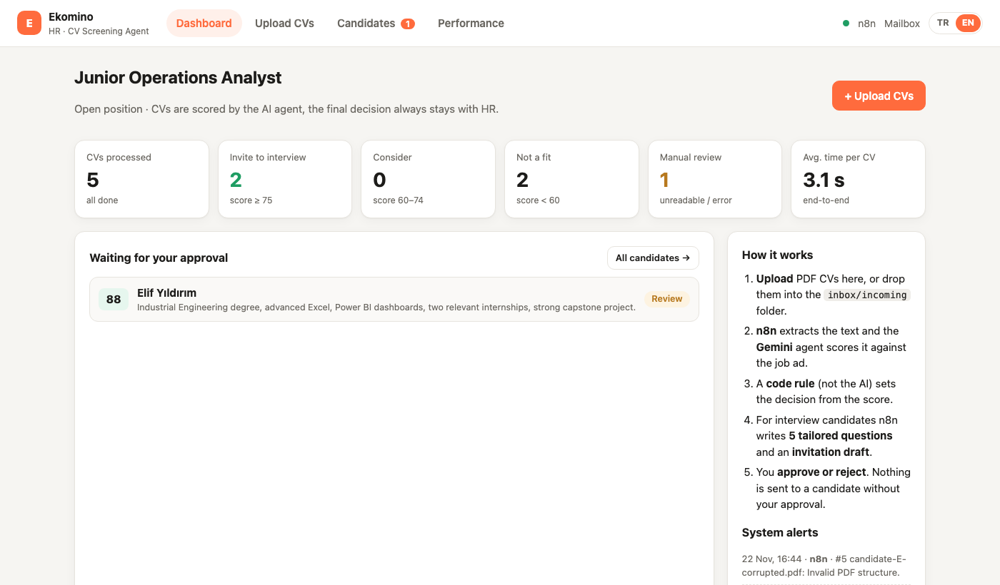
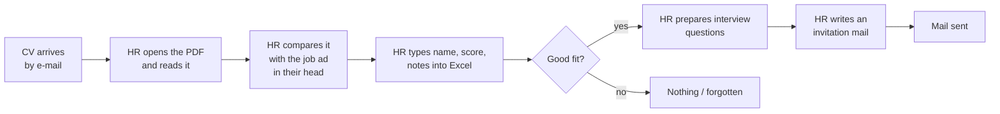
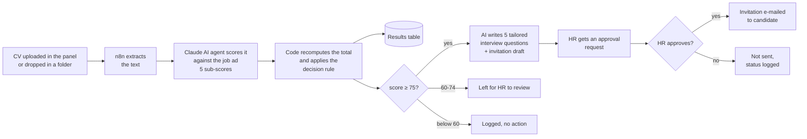
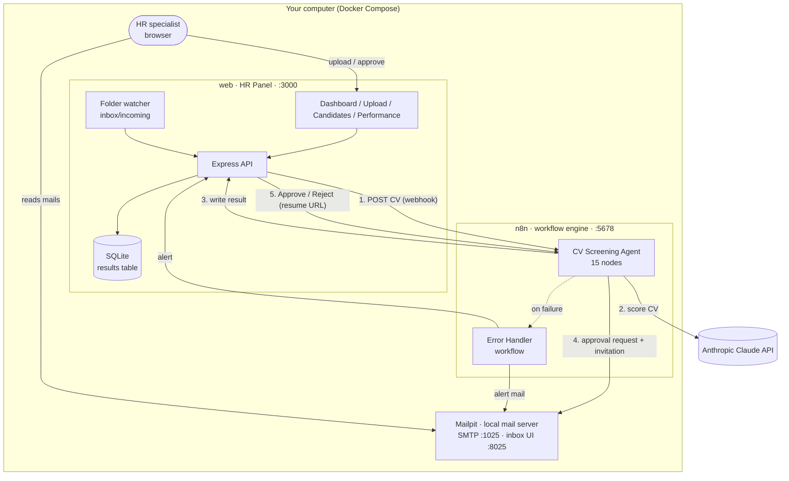
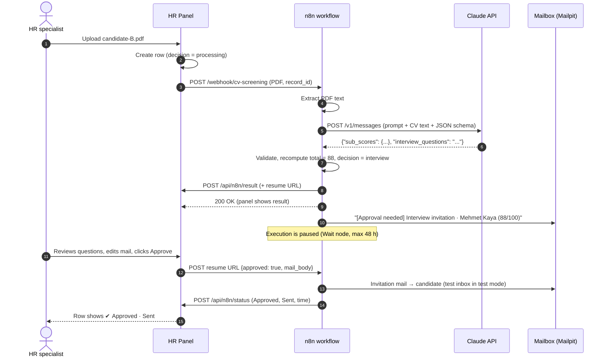
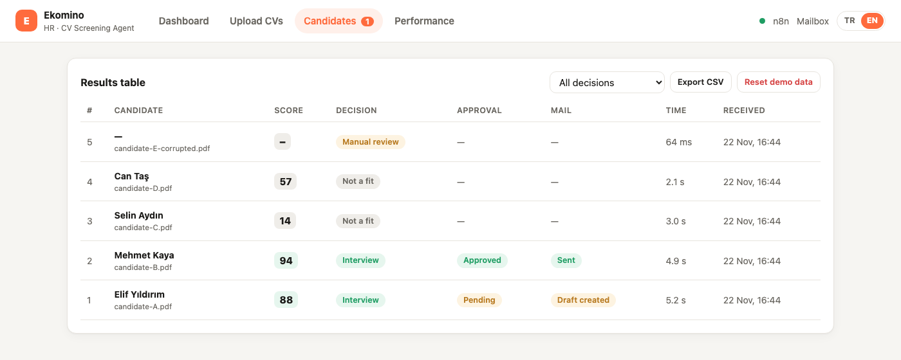
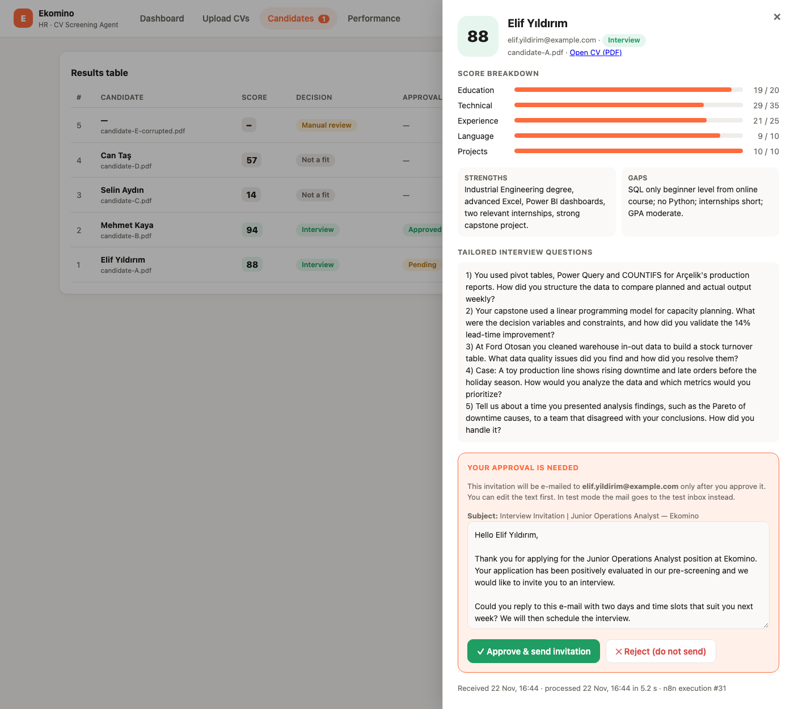
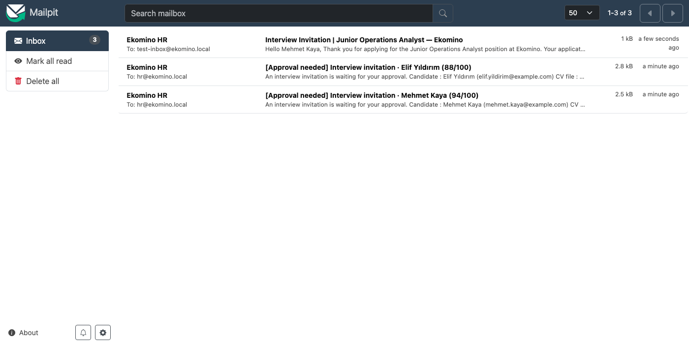
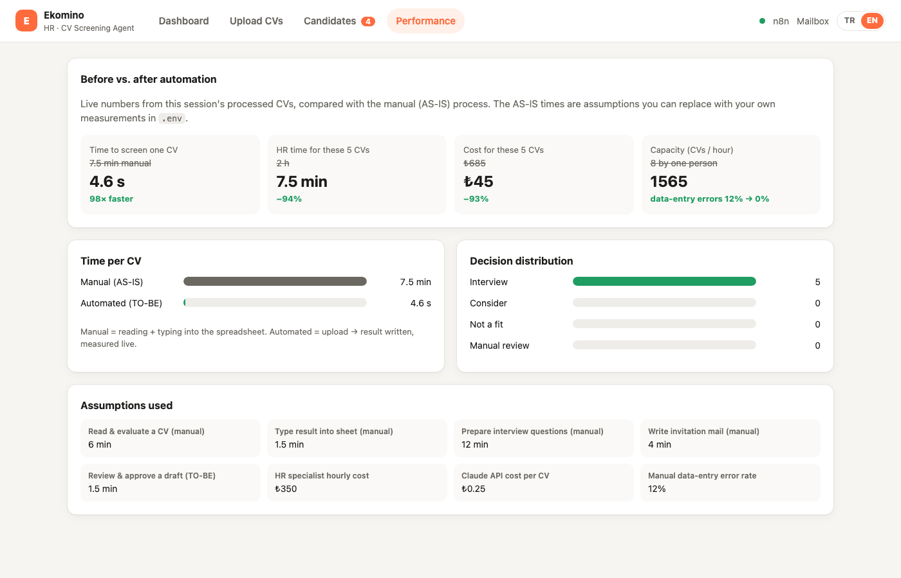

# Ekomino CV Screening Agent

**An AI agent that reads, scores and pre-screens job applications for the HR team of Ekomino (a toy manufacturer), built with n8n and Anthropic's Claude (Sonnet 5.5), with a simple web panel where HR stays in control of every decision.**

> Management Information Systems (MIS), course application project.
> This is **not** a software development assignment. It is an MIS study: we analysed a real
> HR process, found the bottleneck, chose a fitting technology (an AI agent on n8n) and built a
> lean, working automation that creates measurable business value. The small web panel and the
> scripts only exist so the workflow can be run and demonstrated end-to-end on one laptop.

<p align="center">
  
</p>


---

## Contents

1. [Team](#1-team)
2. [The business problem (AS-IS)](#2-the-business-problem-as-is)
3. [Our solution (TO-BE) at a glance](#3-our-solution-to-be-at-a-glance)
4. [Why an AI agent, and why n8n + Claude?](#4-why-an-ai-agent-and-why-n8n--claude)
5. [System architecture](#5-system-architecture)
6. [How it works, step by step](#6-how-it-works-step-by-step)
7. [Installation (run it locally)](#7-installation-run-it-locally)
8. [User guide for the HR specialist](#8-user-guide-for-the-hr-specialist)
9. [Configuration](#9-configuration)
10. [Testing & acceptance criteria](#10-testing--acceptance-criteria)
11. [Performance & gain analysis](#11-performance--gain-analysis)
12. [Requirements traceability (brief → implementation)](#12-requirements-traceability-brief--implementation)
13. [Security, privacy (KVKK) and fairness](#13-security-privacy-kvkk-and-fairness)
14. [Project structure](#14-project-structure)
15. [Troubleshooting](#15-troubleshooting)
16. [Limitations & future work](#16-limitations--future-work)
17. [Live demo & Plan B video](#17-live-demo--plan-b-video)

More detail lives in [`docs/`](docs):
[process analysis](docs/process-analysis.md) ·
[performance analysis](docs/performance-analysis.md) ·
[demo script](docs/demo-script.md) ·
[Q&A / defence notes](docs/defense-qa.md)

---

## 1. Team

| Name | Student no. | Role in the project |
|------|-------------|---------------------|
| _Member 1_ | _..._ | Process analysis (AS-IS interviews, time measurements) |
| _Member 2_ | _..._ | TO-BE design, n8n workflow |
| _Member 3_ | _..._ | Prompt design & AI agent testing |
| _Member 4_ | _..._ | Performance & gain analysis |
| _Member 5_ | _..._ | Presentation, live demo & Plan B video |

**Course:** Management Information Systems · **Instructor:** _..._ · **Term:** _2026–2027 Fall_

---

## 2. The business problem (AS-IS)

Ekomino's HR unit receives CVs for every open position by e-mail. Today **an HR specialist does
every step by hand**:



**What goes wrong**

| Problem | Effect |
|---|---|
| **Time**: every CV is read in full (≈ 6 min) and typed into Excel (≈ 1.5 min); questions and mails for good candidates take another ≈ 16 min | 50 applications ≈ 6+ working hours for one position |
| **Bottleneck**: one person, sequential work | CVs wait days; good candidates accept other offers |
| **Inconsistency**: no written scoring rule, every reader weighs things differently, fatigue after the 20th CV | Same CV gets different results depending on who reads it, and when |
| **Errors**: manual copy-paste into Excel (wrong e-mail, missing row) | Lost or wrongly contacted candidates |
| **Bias risk**: name, age, photo, gender are visible while judging | Unfair and legally risky (equal treatment) |
| **No data**: no record of how long screening takes or why someone was rejected | Process cannot be measured or improved |

Full analysis, with the process map and how the time estimates were made: **[docs/process-analysis.md](docs/process-analysis.md)**.

---

## 3. Our solution (TO-BE) at a glance



**What changes**

* HR no longer reads every CV. The agent does the first pass in **seconds**, with **the same
  rubric every time**.
* The **decision is made by a fixed rule in code**, not by the AI: ≥ 75 → *interview*,
  60-74 → *consider*, < 60 → *not a fit*. Unreadable files go to *manual review*.
* For strong candidates, the agent prepares **5 interview questions specific to that CV**
  and an **invitation e-mail draft**.
* **Human in the loop:** nothing is sent to a candidate until an HR specialist presses
  **Approve** in the panel (and they can edit the text first). The final decision always stays with HR.
* Every candidate, and every step, is **recorded** (results table, timestamps, n8n execution log),
  so the process becomes measurable.

---

## 4. Why an AI agent, and why n8n + Claude?

### RPA or AI agent?

| | RPA bot (UiPath, Power Automate) | AI agent (LLM in a workflow) |
|---|---|---|
| Best at | Repetitive clicks on **structured** screens and forms | Understanding **unstructured** text and making judgements |
| Our input | Every CV has a different layout, language (TR/EN), wording | ✔ The model reads any layout |
| Our task | "Is this person a good fit for *this* job ad?" (judgement) | ✔ Rubric-based scoring + writing questions/mails |
| Would RPA work? | Only for moving the file around; it cannot *evaluate* a CV | |

**Conclusion:** the bottleneck is **reading and judging free text**, which is exactly what a
language model does well. So we chose an **AI agent**, but wrapped it in a deterministic
workflow (fixed steps, fixed rule, human approval), because hiring decisions must be
explainable and controllable.

### Why n8n?

* Visual workflow: every step of the TO-BE process is a box you can **see and explain** in the presentation.
* Built-in nodes for what we need: webhook trigger, PDF text extraction, HTTP/API calls, code,
  if/else, e-mail, and **"wait for approval"** (pauses the run until HR answers).
* Open source and **self-hosted**: it runs in Docker on our own laptop, so CVs are not stored in a third-party automation cloud.
* Execution history: every run's duration and data can be inspected, which we used for the performance analysis.

### Why Claude Sonnet 5.5 (`claude-sonnet-5-5`)?

* Strong reading of Turkish **and** English CVs (our CVs are Turkish, the output is English),
  and good at following a detailed rubric and fairness rules.
* **Structured outputs**: we send a JSON schema (`output_config.format`) and the answer is
  guaranteed to match it, so the workflow can always parse it.
* **Fast and cheap enough**: 2-5 seconds per CV in our tests, about **$0.006 per CV**
  (≈ 1,500-1,800 input and 160-440 output tokens; Sonnet 5.5 costs $2 / $10 per million tokens).
* **Effort control**: `effort: "medium"` is enough for scoring; it can be raised for harder positions.
* **Refusal fallback**: if a safety classifier ever declines a request, the API re-runs it on a
  fallback model inside the same call (`fallbacks: "default"`), so a CV is not lost.
* Alternatives we considered: **Google Gemini** (we started with it, but the model we targeted was
  closed to new API keys and the newer models were overloaded during our tests) and a **local model
  (Ollama)** for privacy, which is much slower on a laptop and weaker in Turkish.

---

## 5. System architecture

Everything runs on one computer with `docker compose`. Only the scoring call goes to the internet (Claude API).



| Component | What it is | Why we need it | Local URL |
|---|---|---|---|
| **n8n** | Workflow automation tool (the core of the project) | Runs the whole screening process: extraction, AI, rule, recording, approval, mailing | http://localhost:5678 |
| **Claude Sonnet 5.5** | Anthropic's large language model, called through the Messages API | Reads and scores the CV, writes interview questions | (cloud) |
| **HR Panel** (`web/`) | Small Node.js web app + SQLite | The end-user screen for HR: upload CVs, see results, approve/reject, export, see gains | http://localhost:3000 |
| **Mailpit** | Local "fake" mail server with a web inbox | Lets us demo real e-mails safely, so nothing reaches a real person | http://localhost:8025 |

> **Mapping to the original brief.** The project brief suggests Google Drive (trigger), Google Sheets (results)
> and Gmail (mail + approval). To make the project run **fully locally, without Google accounts**,
> we used one-to-one local equivalents: Drive folder → `inbox/incoming` folder + upload page;
> Sheets → SQLite results table with identical columns (+ CSV export); Gmail → SMTP to Mailpit;
> Gmail "send and wait for approval" → n8n **Wait** node resumed by the panel's Approve/Reject
> buttons. The workflow logic is identical, and swapping the nodes back is described in §16.

---

## 6. How it works, step by step

### 6.1 The n8n workflow (15 nodes)


| # | Node | Type | What it does | Why |
|---|------|------|--------------|-----|
| 1 | **CV Received** | Webhook | Receives the PDF + `record_id` from the HR panel (`POST /webhook/cv-screening`) | Trigger: every new CV starts the flow automatically (FR-1) |
| 2 | **Settings** | Code | One place for thresholds, test mode, addresses, model name and the **job ad** | Change behaviour without touching the logic (FR-5, FR-11) |
| 3 | **Extract PDF Text** | Extract from File | Turns the PDF into plain text (Turkish characters preserved) | The AI needs text (FR-2). Error output → manual review |
| 4 | **Build AI Request** | Code | Builds the prompt + strict JSON schema for Claude; rejects empty/scanned PDFs | Keeps the prompt readable & versioned; cheap early exit |
| 5 | **Claude · Score CV** | HTTP Request | Calls the Claude Messages API (`POST /v1/messages`) with structured output, retries 3× on failure | The AI agent itself (FR-3, FR-4) |
| 6 | **Validate & Decide** | Code | Parses JSON, clamps sub-scores, **recomputes the total**, **applies the decision rule** | The AI proposes, code decides (FR-5); invalid output → `manual_review` |
| 7 | **Prepare Mail Draft** | Edit Fields (Set) | Fills the invitation template with the candidate's name | Consistent, professional mails (FR-8) |
| 8 | **Save to Results Table** | HTTP Request | Writes every candidate to the results table via the panel API | Every candidate is recorded, whatever the decision (FR-6) |
| 9 | **Respond to Panel** | Respond to Webhook | Tells the panel "done" | The panel does not have to wait for the approval step |
| 10 | **Interview?** | If | Only `interview` candidates continue | Other decisions stop here (brief step 7) |
| 11 | **Ask HR for Approval** | Send Email | Sends HR the summary, questions and the draft, plus a link to the panel | HR is informed (brief step 9) |
| 12 | **Wait for HR Decision** | Wait (resume on webhook) | **Pauses this run** until HR presses Approve/Reject, at most 48 h | Human in the loop (FR-9) |
| 13 | **Approved?** | If | Approve → send; Reject or timeout → do not send | Nothing goes out without approval (FR-9) |
| 14 | **Send Invitation to Candidate** | Send Email | Sends the (possibly edited) invitation; in **test mode** to the test inbox | FR-10, FR-11 |
| 15 | **Update Status** | HTTP Request | Writes `Approved / Rejected / Timed out` and `Sent / Not sent` + time | Approval and mail status are traceable (FR-9, FR-10) |

A separate workflow, **Ekomino · Error Handler** (`Error Trigger → Notify HR + Log Alert to Panel`),
runs automatically if anything in the main workflow crashes (for example the mail server is down).
It e-mails HR and marks the affected candidate as *needs manual handling* in the panel.

### 6.2 One CV's journey (sequence)



### 6.3 The decision rule (code, not AI)

The model returns five sub-scores. The **Validate & Decide** node then:

1. clamps each sub-score to its maximum (education 20, technical 35, experience 25, language 10, projects 10),
2. **recomputes the total** as the sum (the model's own total is ignored, but kept as `model_score` for transparency),
3. applies the thresholds from **Settings**:

| Score | Decision | What the system does |
|---|---|---|
| **≥ 75** | `interview` | Questions + invitation draft, approval request to HR, mail after approval |
| **60-74** | `consider` | Recorded, left for HR to review, no automatic mail |
| **< 60** | `reject` (shown as *Not a fit*) | Recorded, no further action |
| unreadable / invalid AI output / API error | `manual_review` | Recorded with the reason, HR alerted, **the flow never stops** |

Why? A language model can make arithmetic or consistency mistakes. With this design a model
mistake can change a sub-score, but **it can never break the rule itself**, and the rule is
written down, auditable and changeable in one place.

### 6.4 The prompt (AI agent design)

The full prompt is in the **Build AI Request** node. In short:

* **Role:** "experienced HR pre-screening assistant for Ekomino".
* **Context:** the job ad (title + requirements, taken from Settings, so any position can be screened).
* **Rubric:** weights per category, total 100.
* **Rules:** ignore name, gender, age, photo, marital status; do not invent facts; if unsure score lower;
  questions only for interview candidates: 2 technical, 1 experience, 1 case, 1 behavioural,
  **specific to this CV**; never ask about age, marital status, family plans or religion; answer in English.
* **Output contract:** a JSON schema passed as `output_config.format` (`type: json_schema`), so the
  answer always has exactly the fields the workflow expects.
* **Model settings:** `claude-sonnet-5-5`, `effort: "medium"`. This model does not accept a custom
  `temperature`; repeatability comes from the fixed rubric, the schema and the code-side decision
  rule, and we measured it (see the consistency test in the performance analysis).

### 6.5 Fault tolerance

| What can fail | What happens |
|---|---|
| Corrupted / scanned (image-only) PDF | Extract or Build step fails → red error output → `manual_review` with the reason |
| Claude API error (no internet, rate limit, wrong key) | 3 automatic retries, then `manual_review` with a readable reason (`Claude API error 429: ...`) |
| The AI declines to answer (safety classifier) | Fallback model answers inside the same call; if that also declines → `manual_review` |
| AI answer is not valid JSON | `manual_review` ("The AI answer was not valid JSON") |
| n8n is down / does not answer | The panel itself marks the CV `manual_review` after a timeout. The CV is never lost |
| Mail server down, or any unexpected crash | **Error Handler** workflow: alert in the panel + mail to HR; the candidate is flagged for manual handling |
| HR does not answer for 48 h | Wait node times out → status `Timed out`, mail not sent |
| 30 CVs uploaded at once | The panel queues them (2 at a time) so the API rate limit is not exceeded |

---

## 7. Installation (run it locally)

### Prerequisites

* **Docker Desktop** (Mac / Windows) or Docker Engine + Compose (Linux): https://www.docker.com/products/docker-desktop
* An **Anthropic API key** with a few dollars of credit: https://platform.claude.com/settings/keys (screening 100 CVs costs about $0.60)
* ~1.5 GB free disk space, ports **3000**, **5678** and **8025** free

### Steps

```bash
# 1. Get the code
git clone https://github.com/hkankyilmaz/ekomino-cv-screening.git
cd ekomino-cv-screening

# 2. Add your Anthropic (Claude) API key
cp .env.example .env
#    open .env and replace  paste-your-key-here  with your key

# 3. Start everything (first run downloads the images, ~2-3 minutes)
docker compose up -d --build

# 4. Check that all three services are up
docker compose ps
```

Then open:

| What | URL |
|---|---|
| **HR Panel** (start here) | http://localhost:3000 |
| Mailbox (all e-mails the system sends) | http://localhost:8025 |
| n8n editor (to show/inspect the workflow) | http://localhost:5678 |

> **First time you open n8n**, it asks you to create an owner account. This is a local account
> stored only on your computer; any e-mail/password works. The workflows and credentials are
> already imported and active, so you do not need to configure anything inside n8n.

### What happens at start-up

`n8n/start.sh` runs before n8n starts and:
1. creates the two **credentials** (Claude API key from `.env`, local SMTP), stored encrypted inside n8n,
2. **imports** the workflows from `n8n/workflows/` (the repo is the single source of truth),
3. **publishes** (activates) the main workflow and the error handler.

### Stop / reset

```bash
docker compose down          # stop (data is kept)
docker compose down -v       # stop and delete all data (n8n history, results table)
```

---

## 8. User guide for the HR specialist

### 8.1 Dashboard
Shows the open position, counters per decision, the average processing time, the list of
**candidates waiting for your approval**, and system alerts (e.g. a corrupted file).

### 8.2 Upload CVs
Drag & drop one or more PDF CVs (up to 50 at once) or click to choose them. Each file is queued
and processed in the background. **Alternative:** copy PDFs into the `inbox/incoming/` folder of the
project; they are picked up automatically within a few seconds and moved to `inbox/processed/`.

<p align="center"></p>


### 8.3 Candidates (results table)
One row per CV: candidate, score, decision, approval status, mail status, processing time.
Filter by decision or "waiting for approval", **Export CSV** (same columns as the brief's
Google Sheet), or **Reset demo data** before a presentation.

### 8.4 Reviewing and approving a candidate
Click a row to open the detail drawer (real output of the agent for sample candidate A):

* score breakdown (5 bars) and strengths / gaps,
* **tailored interview questions** (interview candidates only),
* the **invitation draft**, which you can edit,
* **Approve & send invitation** or **Reject (do not send)**,
* a link to open the original CV.

<p align="center"></p>


After you approve, n8n continues the paused run and sends the mail. The row changes to
**Approved · Sent**. Open the **Mailbox** (http://localhost:8025) to see it. The approval request
that HR receives by mail contains a link that opens this drawer directly.

<p align="center"></p>

### 8.5 Performance tab
Live before/after comparison for the CVs processed in this session: time per CV, HR hours,
cost, capacity, plus the assumptions used. See §11.

<p align="center"></p>

---

## 9. Configuration

### 9.1 In n8n → workflow **Ekomino · CV Screening Agent** → node **Settings**

| Setting | Default | Meaning |
|---|---|---|
| `THRESHOLD_INTERVIEW` | `75` | Minimum score for *interview* (inclusive) |
| `THRESHOLD_CONSIDER` | `60` | Minimum score for *consider* (inclusive) |
| `TEST_MODE` | `true` | `true` → every candidate mail goes to `TEST_RECIPIENT` instead of the real candidate |
| `TEST_RECIPIENT` | `test-inbox@ekomino.local` | Where candidate mails go in test mode |
| `HR_EMAIL` / `SENDER_EMAIL` | `hr@ekomino.local` | Approval requests go to HR; mails are sent from this address |
| `AI_MODEL` | `claude-sonnet-5-5` | Claude model used for scoring |
| `AI_EFFORT` | `medium` | How much the model thinks (`low` / `medium` / `high`); higher = slower and more expensive |
| `JOB_TITLE`, `JOB_REQUIREMENTS` | Junior Operations Analyst | The job ad the CVs are scored against |

> Changes made in the n8n editor are overwritten on the next restart, because the repo files are
> re-imported. To keep them, run `./scripts/export-workflows.sh` and commit the result,
> or edit `n8n/workflows/cv-screening-agent.json` directly.

### 9.2 In `.env`

| Variable | Meaning |
|---|---|
| `ANTHROPIC_API_KEY` | Your Claude API key (never committed, since `.env` is git-ignored) |
| `ASIS_*`, `TOBE_REVIEW_MIN`, `HR_HOURLY_COST_TRY`, `AI_COST_PER_CV_TRY` | Assumptions for the performance & gain analysis (§11) |

After changing `.env`: `docker compose up -d` (recreates the containers with the new values).

---

## 10. Testing & acceptance criteria

`samples/` contains the four fictional CVs from the brief (Turkish, to test character handling)
plus a deliberately corrupted file:

| File | Candidate | Profile | Expected score | Expected decision |
|---|---|---|---|---|
| `candidate-A.pdf` | Elif Yıldırım | Industrial eng., 2 internships, advanced Excel, basic SQL, Power BI | ≈ 80 | interview |
| `candidate-B.pdf` | Mehmet Kaya | Business eng., 2 yrs operations analyst, advanced SQL, Python, Power BI | ≈ 88 | interview |
| `candidate-C.pdf` | Selin Aydın | Graphic design, unrelated field | ≈ 28 | reject |
| `candidate-D.pdf` | Can Taş | Business admin., intermediate Excel, no SQL, part-time sales | ≈ 55-65 | reject or consider |
| `candidate-E-corrupted.pdf` | – | Broken PDF | – | manual_review |

Run the whole acceptance test with one command:

```bash
./scripts/run-acceptance-test.sh --reset
```

It uploads all five files, waits, and prints actual vs. expected results.

**Our result (22 Nov 2026, Claude Sonnet 5.5): 5/5 decisions as expected.** A → 88 interview, B → 94 interview,
C → 14 not a fit, D → 57 not a fit, E → manual review; 2-5 s per CV. Details in
[docs/performance-analysis.md](docs/performance-analysis.md#4-measured-results-to-be).

**Acceptance checklist (brief §7)**

- [ ] 4 CVs → 4 rows in the results table within 5 minutes, no errors
- [ ] A and B have tailored interview questions; C and D have none
- [ ] For A and B an approval request reaches HR (Mailbox); nothing is sent to the candidate before approval
- [ ] Approve → invitation arrives in the test inbox; Reject → nothing is sent; both update the table
- [ ] A corrupted PDF or invalid AI output does not stop the flow; the candidate becomes `manual_review`

---

## 11. Performance & gain analysis

Summary for one position with **50 applications** (scenario: 10 interview, 10 consider,
2 manual review, 28 not a fit) using the default assumptions in `.env`:

| Indicator | AS-IS (manual) | TO-BE (automated) | Change |
|---|---|---|---|
| Time to screen one CV | ≈ 7.5 min | 2-5 s (measured, see §10) | ≈ 100-200× faster |
| HR time for 50 CVs | ≈ 8.9 h | ≈ 1.5 h (review 10 drafts + read 12 borderline/manual CVs) | **≈ −84 %** |
| Cost for 50 CVs (₺350/h HR cost) | ≈ ₺3,120 | ≈ ₺508 HR + ≈ ₺13 API ($0.30) ≈ ₺521 | **≈ −83 %** |
| Capacity | ≈ 8 CVs/hour per person | hundreds of CVs/hour, 24/7 | no longer limited by HR hours |
| Consistency | depends on reader & fatigue | same rubric, schema-constrained output, rule in code | ✔ |
| Data-entry errors | ≈ 12 % of rows (assumption) | 0, since fields are written by the system | ✔ |
| Measurability | none | every run timed and logged | ✔ |

How these numbers are calculated, the measurement method and our test results:
**[docs/performance-analysis.md](docs/performance-analysis.md)**. The **Performance** tab in the panel computes the
same comparison live from the CVs you process.

---

## 12. Requirements traceability (brief → implementation)

| ID | Requirement (brief) | Where / how |
|---|---|---|
| FR-1 | Every new CV is processed automatically | Panel upload and `inbox/incoming` folder watcher → webhook trigger |
| FR-2 | Text extracted, Turkish characters intact | *Extract PDF Text* node; Turkish sample CVs |
| FR-3 | 0-100 score + 5 sub-scores (20/35/25/10/10) | Prompt + JSON schema + clamping in *Validate & Decide* |
| FR-4 | Fixed JSON schema | `responseSchema` in *Build AI Request* |
| FR-5 | Decision rule in code, thresholds in one place | *Validate & Decide* + *Settings* |
| FR-6 | Every candidate recorded | *Save to Results Table* runs for every decision, including errors |
| FR-7 | 5 CV-specific questions only for interview | Prompt rule + code clears questions for other decisions |
| FR-8 | Invitation draft created | *Prepare Mail Draft*, shown/editable in the panel and sent to HR |
| FR-9 | No mail without HR approval; approval/reject/timeout tracked | *Wait for HR Decision* + *Approved?* + *Update Status* |
| FR-10 | Mail sent after approval, time recorded | *Send Invitation to Candidate* + `mail_sent_at` |
| FR-11 | Test mode | `TEST_MODE` / `TEST_RECIPIENT` in *Settings* |
| FR-12 (optional) | 48 h reminder | 48 h limit on the Wait node, status becomes `Timed out` (reminder mail: future work) |
| NFR | Error workflow, never crash | Error outputs → `manual_review`; *Error Handler* workflow |
| NFR | Consistency (brief asks for temperature 0) | Sonnet 5.5 does not accept a custom temperature; fixed rubric + JSON schema + code-side rule instead, consistency measured (docs/performance-analysis.md §4) |
| NFR | Security | API key only in `.env` → n8n credential (encrypted), never in workflow files |
| NFR | Fairness | Prompt forbids using / asking about protected attributes |
| NFR | Measurability | `processing_ms`, timestamps, n8n execution log, Performance tab |
| NFR | Simplicity | One workflow, 15 nodes (+ 3-node error handler) |

---

## 13. Security, privacy (KVKK) and fairness

* **API key:** lives only in `.env` (git-ignored) and is stored **encrypted** as an n8n credential.
  It never appears in the workflow JSON or in this repo.
* **Where data goes:** CVs and results stay on the local machine (Docker volumes). Only the extracted
  CV *text* is sent to the Claude API for scoring. Anthropic does not train its models on API
  inputs by default. For a real deployment, Ekomino should also add the
  processing to its KVKK privacy notice (*aydınlatma metni*), and agree a retention period with legal.
* **Data minimisation:** the results table only keeps what HR needs (name, e-mail, scores, short notes).
* **Fairness:** the prompt explicitly forbids using name, gender, age, photo or marital status, and
  forbids non-job-related interview questions. Scores are explainable (5 sub-scores + strengths/gaps).
* **Human oversight:** the AI never rejects or invites anyone on its own. *Interview* still needs
  HR approval, and *consider* / *manual review* are decided by HR.
* **Safe demo:** all mails go to the local Mailpit server, and test mode redirects candidate mails
  to a test address.

---

## 14. Project structure

```
ekomino-cv-screening/
├── docker-compose.yml          # n8n + HR panel + Mailpit, one command to start
├── .env.example                # copy to .env, add ANTHROPIC_API_KEY
├── n8n/
│   ├── start.sh                # imports credentials & workflows, publishes them, starts n8n
│   └── workflows/
│       ├── cv-screening-agent.json   # main workflow (15 nodes)
│       └── error-handler.json        # error workflow
├── web/                        # HR panel (end-user interface)
│   ├── server.js               # API, queue, folder watcher, n8n callbacks
│   ├── db.js                   # SQLite results table
│   ├── public/                 # index.html, app.js, style.css (no build step)
│   └── Dockerfile
├── samples/                    # test CVs A–E (+ HTML sources)
├── inbox/incoming/             # drop PDFs here → processed automatically
├── scripts/
│   ├── run-acceptance-test.sh  # brief §7 acceptance test
│   └── export-workflows.sh     # save n8n editor changes back to the repo
└── docs/
    ├── process-analysis.md     # AS-IS / TO-BE analysis
    ├── performance-analysis.md # before/after numbers & method
    ├── demo-script.md          # 3-minute live demo + Plan B video
    └── defense-qa.md           # likely questions & answers
```

---

## 15. Troubleshooting

| Symptom | Cause / fix |
|---|---|
| Every CV ends in **Manual review** with `Claude API error 401: invalid x-api-key` | Put a valid key in `.env`, then `docker compose up -d` |
| `Claude API error 400 ... credit balance is too low` | Add credit to the Anthropic account |
| `Claude API error 429` | Rate limit. Wait a minute, or lower `CONCURRENCY` in `docker-compose.yml` |
| `Claude API error 529` (overloaded) | Temporary; the node retries 3×, otherwise process the CV again later |
| Red dot next to "n8n" in the panel | n8n is still starting (≈ 20 s) or crashed: `docker compose logs n8n` |
| Port already in use | Another app uses 3000/5678/8025. Stop it or change the left side of the port mapping in `docker-compose.yml` |
| Approve shows "Could not send the decision to n8n" | The 48 h window expired, or the run was stopped/restarted. Process the CV again |
| Edits in the n8n editor disappeared | Workflows are re-imported on start, see §9.1 (`./scripts/export-workflows.sh`) |
| Want to see exactly what happened | n8n → **Executions**: every run, every node's input/output and duration |

---

## 16. Limitations & future work

* **Google Workspace version:** replace *Webhook* with *Google Drive Trigger*, *Save to Results Table* with
  *Google Sheets → Append*, *Send Email* with *Gmail*, and *Ask HR + Wait* with Gmail's
  *Send and Wait for Response (approval)*. The logic nodes (Settings, Build AI Request, Validate & Decide)
  stay exactly the same.
* Scanned (image-only) CVs currently go to manual review; Claude can read PDFs directly (as a document input), which would handle them.
* A 48 h reminder mail to HR (optional FR-12) before the timeout.
* Interview scheduling, candidate replies and ATS integration are out of scope (as in the brief).
* Bias monitoring: periodically compare score distributions across groups on anonymised data.
* Authentication on the HR panel for a multi-user/production setup (it is a local demo now).

---

## 17. Live demo & Plan B video

The 3-minute demo script (who says what, which screen, in which order) and the checklist for
the **Plan B screen recording** (required by the assignment in case the internet or the API
fails during the presentation) are in **[docs/demo-script.md](docs/demo-script.md)**.

---

<sub>Ekomino is a fictional company used for this course project. All candidate data in `samples/` is fictional.</sub>
