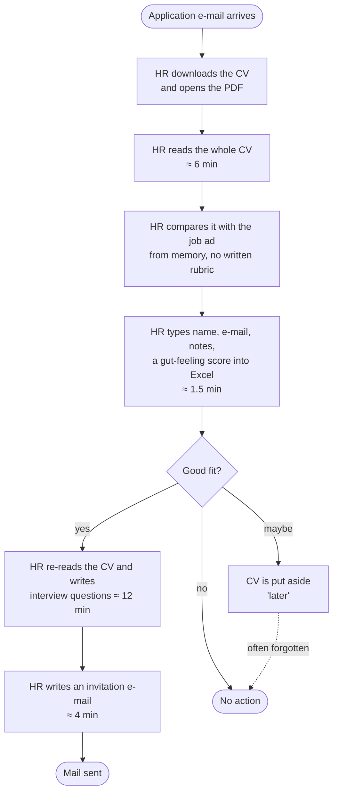
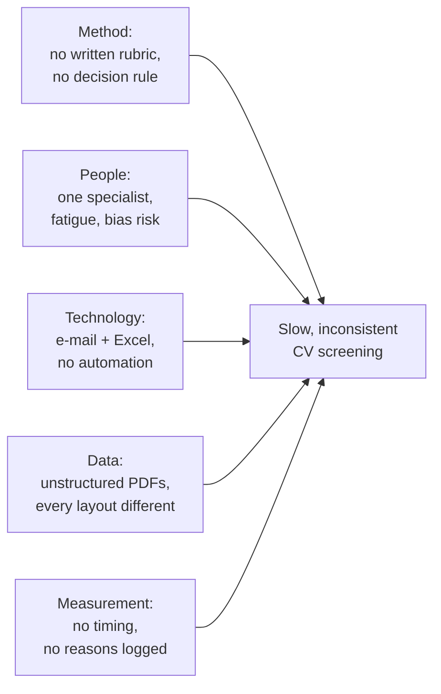
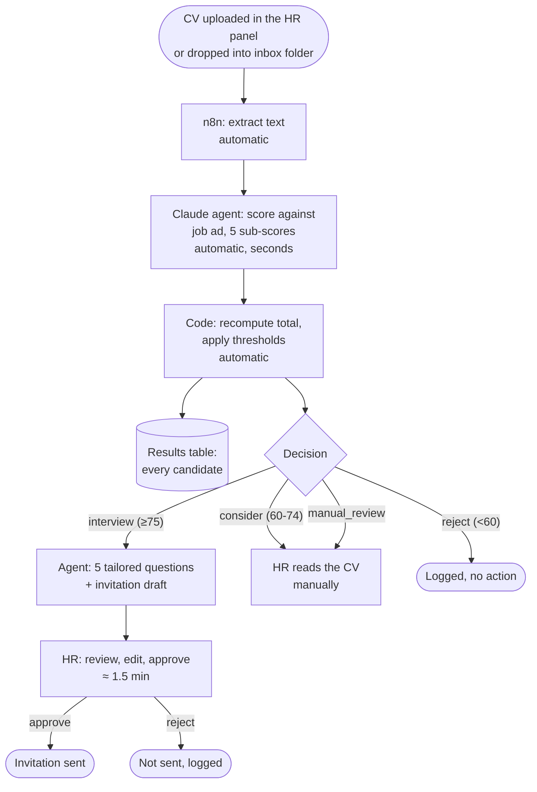

# Process Analysis: AS-IS and TO-BE

[← back to README](../README.md)

## 1. Context

| | |
|---|---|
| **Company** | Ekomino, a toy manufacturer (fictional case) |
| **Unit** | Human Resources |
| **Process** | CV pre-screening for open positions, from "CV received" to "candidate invited / not invited" |
| **Example position** | Junior Operations Analyst |
| **Process owner** | HR specialist |
| **Volume** | Typically 30-80 applications per open position, several positions per quarter |

## 2. AS-IS process

### 2.1 Process map

### 2.2 Activities, time and pain points

| # | Activity | Who | Time (estimate) | Value? | Pain point |
|---|---|---|---|---|---|
| 1 | Download & open the CV | HR | 0.5 min | No (handling) | Files scattered in mailbox |
| 2 | Read & evaluate the CV | HR | **6 min** | Yes, but repetitive | Fatigue; no rubric → inconsistent |
| 3 | Record result in Excel | HR | 1.5 min | No (transcription) | Typos, missing rows, wrong e-mails |
| 4 | Prepare interview questions | HR | **12 min** | Yes | Generic questions, not tailored |
| 5 | Write invitation e-mail | HR | 4 min | Partly | Repetitive text, varying tone |
| 6 | Track who was contacted | HR | – | No | Not tracked; "maybe" candidates forgotten |

> The times are typical-case estimates used throughout this project. To make the analysis
> stronger, each group member should time themselves screening the sample CVs with a stopwatch
> (method in [performance-analysis.md](performance-analysis.md#2-how-to-measure-the-as-is-times))
> and replace the values in `.env` with the group's averages.

### 2.3 Root-cause view (why is it slow and inconsistent?)

### 2.4 Bottleneck

The **bottleneck is activity 2 (reading & judging every CV)**, together with activity 4 for
good candidates. They are done by one person, sequentially, and they scale linearly with the
number of applications. Everything else waits for them.

### 2.5 Why automate this process? (suitability)

| Criterion | Assessment |
|---|---|
| High volume, repetitive | ✔ Dozens of CVs per position, same steps every time |
| Clear rules can be written | ✔ The job ad + weights become a rubric; thresholds become a rule |
| Digital input | ✔ CVs arrive as PDF |
| Measurable outcome | ✔ Time, cost, consistency, errors |
| Needs judgement on free text | ✔ → an **AI agent**, not classic RPA |
| High-stakes decision | ⚠ → keep a **human in the loop** for the final decision |

## 3. TO-BE process

### 3.1 Process map

### 3.2 What changed, activity by activity

| AS-IS activity | TO-BE | Who/what does it |
|---|---|---|
| Download & open CV | Upload / drop in folder (bulk) | HR (seconds for many files) |
| Read & evaluate | Rubric-based scoring | **AI agent** (Claude) |
| Decide | Fixed thresholds in code | **n8n code node** |
| Record in Excel | Written automatically, every candidate | **n8n → results table** |
| Write questions | Generated, tailored to the CV | **AI agent** |
| Write invitation | Template filled automatically | **n8n** |
| Send invitation | Only after approval | **HR approves**, n8n sends |
| Track status | Approval & mail status + timestamps | **n8n → results table** |

HR's role moves from **doing** the screening to **supervising** it: approving invitations and
looking only at the borderline (*consider*) and problematic (*manual review*) cases.

### 3.3 Design principles we followed

1. **Lean, not complex.** One workflow, 15 nodes, standard n8n nodes. No custom servers for the logic.
2. **AI for judgement, code for rules.** The model proposes; a deterministic rule decides.
3. **Human in the loop** for anything that reaches a candidate.
4. **Never lose a CV.** Every failure path ends in a recorded `manual_review`.
5. **Measurable by design.** Every run is timed and logged.
6. **Fair by design.** Protected attributes are excluded in the prompt; scores are explainable.

## 4. Technology choice: summary

| Option | Fit | Why / why not |
|---|---|---|
| Classic RPA (UiPath / Power Automate) | ✖ for scoring | Good at clicking through structured screens, cannot evaluate free-text CVs |
| Custom GPT / chat assistant | ✖ | Manual copy-paste per CV, no integration, no record, no approval flow |
| Multi-agent framework (CrewAI) | ✖ overkill | Coding-heavy; one well-designed agent call is enough here |
| **n8n + Claude (AI agent in a workflow)** | ✔ | Visual, self-hosted, built-in PDF/HTTP/mail/approval nodes; LLM reads any CV layout |
| Local LLM (Ollama) instead of a cloud model | ~ | Best privacy, but slow on a laptop and weaker in Turkish; kept as future option |
